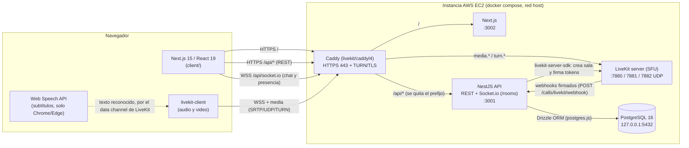
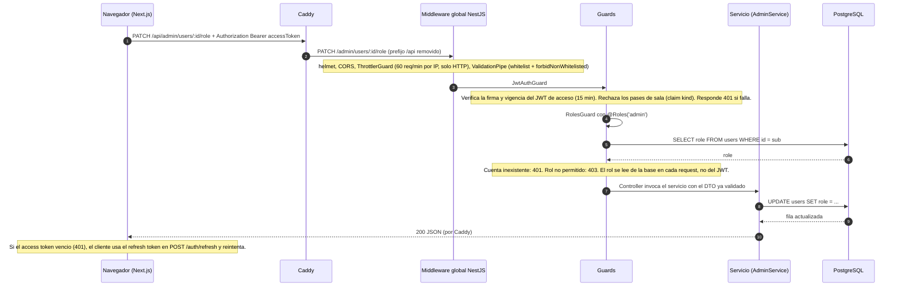

# Arquitectura de Date2gether

Este documento describe cómo está organizado el sistema, cómo viaja una petición desde el navegador hasta la base de datos, qué datos se guardan y qué endpoints existen. Para el porqué de cada tecnología, ver [justificacion.md](justificacion.md); para el registro cronológico de decisiones, ver [decisiones-tecnicas.md](decisiones-tecnicas.md).

## 1. Vista general



Puntos clave, verificables en `deploy/ec2/compose.yaml` y `deploy/ec2/configure.py`:

- En producción todo corre en **una sola instancia EC2** con Docker Compose y `network_mode: host`. Caddy es el único punto de entrada público (puertos 80, 443, 7881 TCP; 3478 y 7882 UDP).
- Caddy enruta `/api/*` al backend (quitando el prefijo `/api`) y el resto al frontend, de modo que el navegador usa **un solo origen HTTPS** y se evitan problemas de contenido mixto y CORS.
- PostgreSQL escucha solo en `127.0.0.1`; ni la API, ni LiveKit interno ni la base están abiertos en el Security Group.
- El audio y el video **no pasan por el backend**: el navegador se conecta directamente a LiveKit con un token de corta duración que emite el backend.
- Los subtítulos se reconocen en el navegador de cada persona (Web Speech API); el backend solo guarda las frases finales en `transcript_lines`. La única llamada a un modelo de IA desde el servidor es el resumen de una llamada, que envía la transcripción guardada a la API de Gemini (`src/modules/ai-summary/`); la clave `GEMINI_API_KEY` solo existe en el entorno del backend.

## 2. Recorrido de una petición (navegador a base de datos y vuelta)

Ejemplo: una persona con cuenta pide `PATCH /admin/users/:id/role` desde el panel `/admin`.



### Dónde se comprueba la identidad y los permisos

Hay **tres tipos de credencial** y **cuatro mecanismos de autorización**; cada uno resuelve una pregunta distinta.

| Credencial | Qué es | Vigencia | Quién la verifica |
| --- | --- | --- | --- |
| JWT de acceso de cuenta | `{ sub, email }` firmado con `JWT_ACCESS_SECRET` | 15 min (configurable con `JWT_ACCESS_EXPIRES_IN`) | `JwtAuthGuard` |
| Refresh token | JWT con `jti`; en la base solo se guarda su hash bcrypt (`refresh_tokens.token_hash`) | 7 días; se rota en cada uso y su reutilización revoca todas las sesiones de la cuenta | `AuthService.refresh` |
| Pase de sala | JWT con `kind: 'room-participant'`, id aleatorio, sala y nombre; `userId` solo si el acceso fue con cuenta | 24 h | `RoomAccessGuard` (HTTP) y `WsJwtAuthGuard` (WebSocket) |

| Mecanismo | Pregunta que responde | Dónde se aplica |
| --- | --- | --- |
| `JwtAuthGuard` | ¿Hay una cuenta con sesión válida? | Controladores de cuenta, creación y administración de salas, historial, `/admin/*` |
| `RolesGuard` + `@Roles('admin')` | ¿La cuenta tiene el **rol global** requerido (`user` o `admin`)? Lee `users.role` de la base. | `AdminController` (todo el controlador) |
| `RoomRolesGuard` + `@RoomRoles(...)` | ¿La cuenta tiene el **rol por sala** requerido (`administrador`, `colaborador`, `participante`) en la sala del parámetro `:code`? | Administración de miembros, nombre, admisión, agenda y emojis de una sala |
| `RoomAccessGuard` / `WsJwtAuthGuard` | ¿El pase de sala es válido y pertenece a **esa** sala (se compara por `roomId`, no solo por código, porque los códigos se reciclan)? | Llamadas, transcripciones, GIFs, búsqueda de música, notas y todos los eventos de Socket.io |

Notas verificables en el código:

- `JwtAuthGuard` rechaza cualquier token con claim `kind`, de modo que un invitado con pase de sala **no puede** crear salas ni administrar roles (`src/modules/auth/guards/jwt-auth.guard.ts`).
- `RolesGuard` y `RoomRolesGuard` son independientes a propósito: el rol global gobierna la plataforma y el rol de sala gobierna una sala concreta (decisión 22 en [decisiones-tecnicas.md](decisiones-tecnicas.md)).
- `DELETE /rooms/:code` valida el rol de administrador de sala dentro de `RoomsService.deleteRoomAsAdmin`, no con `RoomRolesGuard` (decisión 23).
- El webhook de LiveKit (`POST /calls/livekit/webhook`) no usa guards de JWT: se autentica con la firma HMAC del header `Authorization` y excluye el límite de peticiones global.
- Los eventos de música en Socket.io comprueban el rol de administrador a mano dentro del handler, porque `RoomRolesGuard` solo opera sobre contexto HTTP (decisión 16).

### Flujo de una llamada

1. La persona confirma su nombre y obtiene un pase de sala (`POST /rooms/:code/access`), que dura 24 h.
2. El navegador pide `POST /calls/:roomCode` con el pase. `RoomAccessGuard` lo valida; `CallsService` crea la sala en LiveKit (idempotente, con `maxParticipants`) y firma un token de LiveKit de 15 min.
3. El navegador se conecta a LiveKit con `livekit-client`. El cupo lo aplica LiveKit al conectar.
4. LiveKit notifica al backend con webhooks firmados; el backend los guarda en `call_events` y, al cerrar la sala, materializa el resumen en `call_sessions` y `call_session_participants` (línea de tiempo de participación).

## 3. Modelo de datos

Derivado de `src/db/schema.ts` (Drizzle ORM). Se omiten columnas menores (colores, parámetros de stickers, constraints). Las migraciones versionadas están en `drizzle/`.

```mermaid
erDiagram
  users {
    uuid id PK
    varchar email UK
    varchar password_hash
    varchar name
    user_role role "user | admin (rol global)"
    jsonb avatar
    timestamp call_history_deleted_before "corte de archivo borrado por la cuenta"
    timestamp created_at
  }
  refresh_tokens {
    uuid id PK "jti del JWT"
    uuid user_id FK
    varchar token_hash "hash bcrypt"
    timestamp expires_at
    timestamp revoked_at
  }
  rooms {
    uuid id PK
    varchar code "unico entre salas no retiradas"
    varchar name
    boolean is_permanent
    boolean waiting_room_enabled
    boolean entry_locked
    timestamp last_entered_at
    timestamp retired_at
    timestamp history_deleted_before "corte de archivo borrado (salas permanentes)"
    boolean history_cleanup_pending "purga en segundo plano pendiente"
    varchar chime_meeting_id "historica, sin uso"
  }
  room_members {
    uuid room_id PK, FK
    uuid user_id PK, FK
    room_role role "administrador | colaborador | participante"
    boolean is_owner "creador; un solo propietario por sala"
    boolean hidden_from_my_rooms "oculta la sala en Mis salas, por cuenta"
    timestamp joined_at
  }
  messages {
    uuid id PK
    uuid room_id FK
    varchar author_name
    message_kind kind "text | gif"
    text content
    timestamp created_at
  }
  room_notes {
    uuid room_id PK, FK
    text content
    int revision
  }
  room_playlists {
    uuid room_id PK, FK
    jsonb tracks
    int current_index
  }
  room_admission_requests {
    uuid id PK
    uuid room_id FK
    uuid user_id FK "null si es invitado"
    varchar name
    admission_status status
    timestamp expires_at
  }
  room_schedule_slots {
    uuid id PK
    uuid room_id FK
    smallint day_of_week
    varchar time_of_day
    varchar timezone
  }
  room_emojis {
    uuid id PK
    uuid room_id FK
    uuid created_by FK
    varchar name
    bytea image
    bytea sound
    call_mode call_mode
  }
  call_history {
    uuid id PK
    uuid room_id FK
    uuid user_id FK
    timestamp started_at
  }
  transcript_lines {
    uuid id PK
    uuid room_id FK
    varchar call_sid "sid de la sala de LiveKit"
    varchar speaker_name
    text content
    timestamp spoken_at
  }
  call_participant_identities {
    uuid id PK
    varchar livekit_identity UK
    uuid room_id FK
    uuid user_id FK "null si es invitado"
    varchar display_name
    room_role role_at_issue
  }
  call_sessions {
    uuid id PK
    varchar livekit_room_sid UK
    uuid room_id FK "SET NULL al borrar la sala"
    varchar room_code
    timestamp started_at
    timestamp ended_at
    varchar close_reason
    timestamp history_purged_at "sesion purgada del archivo de la sala"
  }
  call_session_participants {
    uuid id PK
    uuid session_id FK
    uuid user_id FK
    varchar participant_key
    varchar display_name
    boolean is_guest
    int total_seconds
    jsonb track_intervals
  }
  call_summaries {
    uuid session_id PK, FK "un resumen por sesion"
    text summary
    varchar model
    varchar language "es o en"
    uuid created_by FK "SET NULL al borrar la cuenta"
    timestamp created_at
  }
  call_events {
    varchar id PK "id propio de LiveKit"
    varchar livekit_room_sid
    varchar room_code
    varchar event_type
    jsonb payload
    timestamp occurred_at
  }

  users ||--o{ refresh_tokens : "tiene"
  users ||--o{ room_members : "es miembro"
  rooms ||--o{ room_members : "tiene"
  rooms ||--o{ messages : "contiene"
  rooms ||--o| room_notes : "tiene"
  rooms ||--o| room_playlists : "tiene"
  rooms ||--o{ room_admission_requests : "recibe"
  users |o--o{ room_admission_requests : "solicita"
  rooms ||--o{ room_schedule_slots : "agenda"
  rooms ||--o{ room_emojis : "define"
  users |o--o{ room_emojis : "crea"
  rooms ||--o{ call_history : "registra"
  users ||--o{ call_history : "participa"
  rooms ||--o{ transcript_lines : "guarda"
  rooms ||--o{ call_participant_identities : "emite"
  users |o--o{ call_participant_identities : "se asocia"
  rooms |o--o{ call_sessions : "origina"
  call_sessions ||--o{ call_session_participants : "resume"
  users |o--o{ call_session_participants : "se asocia"
  call_sessions ||--o| call_summaries : "tiene"
  users |o--o{ call_summaries : "genera"
```



Observaciones sobre el modelo:

- Las tablas que cuelgan de `rooms` usan `ON DELETE CASCADE`, por lo que `DELETE FROM rooms` limpia miembros, mensajes, notas, solicitudes, agenda, playlist, emojis, historial, transcripciones e identidades de llamada (decisión 23).
- `room_members.is_owner` marca al creador de la sala. Un índice único parcial permite un solo propietario por sala y una restricción `CHECK` exige que el propietario tenga rol `administrador`. `hidden_from_my_rooms` es una preferencia por cuenta y sala: oculta la sala en la lista "Mis salas" sin quitar el rol ni la sala.
- La retención del historial es de 90 días (`call-history-retention.ts`). Las filas de `call_history` y los mensajes de salas permanentes más antiguos pasan a una vista de **archivo**. Cada cuenta puede vaciar su archivo de llamadas (`users.call_history_deleted_before`), y el administrador de una sala permanente puede vaciar el archivo de la sala (`rooms.history_deleted_before` y `history_cleanup_pending`): un proceso en segundo plano del backend purga por lotes cada 2 segundos y marca `call_sessions.history_purged_at`.
- `call_sessions.room_id` es `ON DELETE SET NULL` y `call_events` **no tiene claves foráneas** a propósito: son un registro histórico que sobrevive al borrado de salas y cuentas. `call_events` se relaciona con `call_sessions` solo de forma lógica, por `livekit_room_sid`.
- `call_summaries.session_id` es la clave primaria y `ON DELETE CASCADE`: hay a lo sumo un resumen por sesión y desaparece con ella. `created_by` es `ON DELETE SET NULL`. La transcripción no se copia: el resumen se genera a partir de `transcript_lines` en el momento de pedirlo.
- `rooms.chime_meeting_id` es una columna histórica de la etapa Amazon Chime; se conserva para no reescribir migraciones y LiveKit no la usa.
- Los archivos de emojis y sonidos se guardan como `bytea` en PostgreSQL porque el despliegue solo respalda la base (`pg_dump`) y el backend no tiene volumen propio.

## 4. API REST y Socket.io

Todas las rutas están bajo `/api` en producción (Caddy quita el prefijo) y sin prefijo en desarrollo local. Los accesos se resumen así: **Cuenta** = JWT de acceso; **Pase** = pase de sala; **Público** = sin credencial; **Rol global** y **Rol de sala** como se describió en la sección 2.

### Salud, cuentas y sesión

| Método | Ruta | Autenticación | Rol requerido | Notas |
| --- | --- | --- | --- | --- |
| GET | `/health` | Público | - | Comprobación del proceso |
| POST | `/auth/register` | Público | - | Crea la cuenta (rol global `user`) |
| POST | `/auth/login` | Público | - | Devuelve `accessToken` y `refreshToken` |
| POST | `/auth/refresh` | Refresh token en el cuerpo | - | Rota el refresh token; su reutilización cierra todas las sesiones |
| POST | `/auth/logout` | Refresh token en el cuerpo | - | Idempotente |
| GET | `/auth/me` | Cuenta | - | Incluye el rol global (`user` o `admin`) |
| PATCH | `/auth/me/color` | Cuenta | - | Color del nombre |
| PATCH | `/auth/me/avatar` | Cuenta | - | Avatar |

### Administración global

| Método | Ruta | Autenticación | Rol requerido | Notas |
| --- | --- | --- | --- | --- |
| GET | `/admin/users` | Cuenta | Rol global `admin` (403 si es `user`, 401 sin token) | `id, email, name, role, createdAt` |
| PATCH | `/admin/users/:id/role` | Cuenta | Rol global `admin` | `{ "role": "user" \| "admin" }`; no permite quitarse el rol a uno mismo |
| DELETE | `/admin/rooms/:code` | Cuenta | Rol global `admin` | Moderación: borra cualquier sala (204) |

### Salas

| Método | Ruta | Autenticación | Rol requerido | Notas |
| --- | --- | --- | --- | --- |
| POST | `/rooms` | Cuenta | - | Crea la sala y registra al creador como `administrador` |
| GET | `/rooms/mine` | Cuenta | - | Salas en las que la cuenta tiene rol `administrador` (creadas o heredadas), incluidas las ocultas (`hiddenFromMyRooms`) |
| PATCH | `/rooms/mine/:roomId/visibility` | Cuenta | Rol de sala `administrador` (validado en el servicio; 404 si no) | `{ "hidden": boolean }`; oculta o muestra la sala en "Mis salas" solo para esa cuenta (204) |
| DELETE | `/rooms/:roomId/archive` | Cuenta | Rol de sala `administrador`, solo salas permanentes (403 si no) | Vacía el archivo de la sala (historial de más de 90 días); la purga se completa en segundo plano (204) |
| GET | `/rooms/:code` | Público | - | Consulta por código |
| DELETE | `/rooms/:code` | Cuenta | Rol de sala `administrador` (validado en el servicio; 403 si no, 404 si no existe) | Responde 204; borrado en cascada |
| POST | `/rooms/:code/access` | Público (cuenta opcional) | - | Cuerpo `{ "name": "Ana" }`; devuelve el pase de sala o una solicitud de espera |
| POST | `/rooms/:code/join` | Cuenta | - | Registra la membresía |
| GET | `/rooms/:code/members` | Cuenta | Miembro de la sala (cualquier rol) | Lista de miembros con su rol y si es propietario (`isOwner`) |
| PATCH | `/rooms/:code/members/:userId` | Cuenta | Rol de sala `administrador` | Cambia el rol por sala. No se puede quitar el rol al propietario ni dejar la sala sin administradores (403); emite `memberRoleChanged` |
| PATCH | `/rooms/:code/name` | Cuenta | Rol de sala `administrador` | Renombra la sala (solo permanentes; 403 si es temporal) |
| GET | `/rooms/:roomCode/messages` | Pase | - | Historial de chat paginado: `view=recent\|archive`, `from` y `to` (un día, ISO 8601) y cursor `before`; el archivo solo existe en salas permanentes |
| GET | `/rooms/:roomCode/notes` | Pase | - | Bloc compartido |
| PATCH | `/rooms/:roomCode/notes` | Pase | - | Guarda con control de revisión |

### Admisión (sala de espera)

| Método | Ruta | Autenticación | Rol requerido | Notas |
| --- | --- | --- | --- | --- |
| GET | `/rooms/:code/admission` | Cuenta | Rol de sala `administrador` | Configuración y solicitudes |
| PATCH | `/rooms/:code/admission` | Cuenta | Rol de sala `administrador` | Activa o desactiva la espera y bloquea ingresos |
| PATCH | `/rooms/:code/admission/:id` | Cuenta | Rol de sala `administrador` | `{ "decision": "admitted" \| "rejected" }` |
| GET | `/rooms/:code/admission/:id/status` | Credencial de espera | - | Estados: `pending`, `admitted`, `rejected`, `cancelled`, `expired` |
| POST | `/rooms/:code/admission/:id/cancel` | Credencial de espera | - | Cancela la solicitud propia |

Con ingreso directo, `POST /rooms/:code/access` devuelve `{ token, participant }`. Con espera activa devuelve `{ status: "pending", requestId, ticket }`, y la consulta de estado devuelve `{ status: "admitted", access: { token, participant } }` solo después de la admisión. Las decisiones sobre solicitudes ya resueltas no se sobrescriben y las solicitudes de otras salas no se pueden consultar ni resolver. El frontend conserva el pase en memoria durante la visita; abrir o recargar el enlace vuelve a pedir confirmación del nombre.

### Agenda y emojis de sala

| Método | Ruta | Autenticación | Rol requerido | Notas |
| --- | --- | --- | --- | --- |
| GET | `/rooms/:code/schedule/next` | Público | - | Próxima ocurrencia de la agenda |
| GET | `/rooms/:code/schedule/slots` | Cuenta | Rol de sala `administrador` | Franjas configuradas |
| POST | `/rooms/:code/schedule/slots` | Cuenta | Rol de sala `administrador` | Crea una franja |
| DELETE | `/rooms/:code/schedule/slots/:slotId` | Cuenta | Rol de sala `administrador` | Elimina una franja |
| GET | `/rooms/:code/emojis` | Público | - | Lista; las imágenes y sonidos se piden por uuid |
| GET | `/rooms/:code/emojis/:id/image` y `/sound` | Público | - | Los elementos `img` y `audio` no pueden enviar `Authorization` |
| GET | `/rooms/:code/emojis/sounds` | Cuenta | Rol de sala `administrador` o `colaborador` | Búsqueda en Freesound |
| POST, PATCH, DELETE | `/rooms/:code/emojis[/:id]` | Cuenta | Rol de sala `administrador` o `colaborador` | Alta, edición y baja |

### Llamadas, transcripciones y servicios auxiliares

| Método | Ruta | Autenticación | Rol requerido | Notas |
| --- | --- | --- | --- | --- |
| POST | `/calls/:roomCode` | Pase | - | Devuelve `{ url, token, roomName, participantLimit }`; token de LiveKit de 15 min |
| POST | `/calls/:roomCode/track-state` | Pase | - | Informa el estado de cámara y micrófono (204) |
| POST | `/calls/livekit/webhook` | Firma HMAC de LiveKit | - | Sin límite de peticiones; responde 200 si la firma es válida |
| GET | `/calls/history` | Cuenta | - | Historial de llamadas de la cuenta, paginado: `view=recent` (últimos 90 días) o `archive`, `roomId` y cursor `before`; devuelve `hasArchived` |
| DELETE | `/calls/history/archive` | Cuenta | - | Vacía el archivo de llamadas de la cuenta (más de 90 días) (204) |
| GET | `/calls/rooms/:roomId/archive` | Cuenta | Haber participado en la sala; solo salas permanentes | Sesiones archivadas de la sala, paginadas con `before` |
| GET | `/calls/history/:roomId/notes` | Cuenta | - | Notas de una sala del historial |
| GET | `/calls/sessions` | Cuenta | - | Sesiones en las que participó la cuenta |
| GET | `/calls/sessions/:sessionId/timeline` | Cuenta | - | Línea de tiempo de participación |
| GET | `/calls/sessions/:sessionId/transcript` | Cuenta | Haber participado (404 si no) | Acta de esa sesión |
| GET | `/calls/sessions/:sessionId/summary` | Cuenta | Haber participado (404 si no) | Resumen guardado: `{ summary }` (`null` si aún no existe) |
| POST | `/calls/sessions/:sessionId/summary` | Cuenta | Haber participado (404 si no); 5 por minuto | Cuerpo opcional `{ language }` con `es` o `en` (por defecto `es`). Devuelve el resumen guardado o lo genera con Gemini. Errores: 422 (sin transcripción), 413 (más de 100 000 caracteres), 429 con `code: AI_QUOTA` (cuota del proveedor), 503 (sin clave o servicio caído) |
| GET | `/calls/sessions/by-sid/:livekitRoomSid` | Cuenta | Haber participado (404 si no) | Devuelve `{ id }` de la sesión |
| POST | `/transcripts/:roomCode` | Pase | - | `{ callSid, content }`; el nombre sale del pase |
| GET | `/transcripts/:roomCode?callSid=` | Pase | - | Acta de esa llamada en orden |
| GET | `/gifs/:roomCode` | Pase | - | Búsqueda de GIFs (Giphy) |
| GET | `/music-search/:roomCode` | Pase | - | Búsqueda de canciones |

### Socket.io

El namespace es `/rooms` y el cliente envía `auth: { token }` con el pase de sala (`WsJwtAuthGuard`). `joinRoom` recibe `{ code }`; el nombre, el identificador y la cuenta se obtienen del pase verificado. `sendMessage` recibe `{ content }` y `leaveRoom` no requiere payload. El servidor emite `roomHistory` (la página más reciente del chat; el resto se pide por REST), `roomUsers`, `userJoined`, `userLeft`, `newMessage`, `memberRoleChanged`, `roomEmojisChanged` y `roomDeleted` (al borrarse la sala, tras lo cual desconecta a los sockets de esa sala); la presencia incluye `{ participantId, userName, userId? }`. El gateway (`src/modules/chat/chat.gateway.ts`) también atiende los eventos de avatar, música ambiental sincronizada, bloqueo de medios, foco por nombre y eventos de sala (`startRoomEvent`, `castPollVote`, `closePollEvent`).

## 5. Organización del repositorio

```text
.
├── src/                    Backend NestJS
│   ├── main.ts, app-setup.ts, app.module.ts   Arranque, helmet, CORS, ValidationPipe, throttling
│   ├── db/                 schema.ts (Drizzle) y DrizzleModule
│   ├── common/             Utilidades: códigos de sala, guard de throttling solo HTTP
│   └── modules/
│       ├── auth/           Cuentas, JWT, refresh tokens, pases de sala, guards
│       ├── admin/          Moderación global (usuarios y salas)
│       ├── rooms/          Salas, miembros, admisión, agenda, RoomRolesGuard
│       ├── chat/           Gateway Socket.io (chat, presencia, música, eventos)
│       ├── calls/          Tokens de LiveKit, webhooks, historial, línea de tiempo
│       ├── transcripts/    Actas de subtítulos
│       ├── room-emojis/    Emojis y sonidos propios de cada sala
│       └── gifs/, music-search/   Integraciones con servicios externos
├── client/                 Frontend Next.js (App Router)
│   └── src/
│       ├── app/            Rutas: /, /login, /register, /rooms, /room/[code], /history, /settings, /admin
│       ├── features/       Código por funcionalidad: auth, calls, chat, rooms, avatar, translation, theme...
│       └── lib/            Clientes de API, sockets y sesión
├── packages/shared/        Tipos y constantes compartidos entre backend y frontend
├── drizzle/                Migraciones SQL versionadas
├── e2e/                    Pruebas end-to-end con Playwright
├── deploy/                 Dockerfile multietapa, LiveKit local y despliegue en EC2 (CloudFormation, Caddy)
├── docs/                   Documentación del proyecto
├── openspec/               Artefactos de desarrollo guiado por especificaciones
├── scripts/                promote-admin.mjs (primer administrador global)
└── .github/workflows/      Integración continua (e2e.yml)
```

Convenciones: las pruebas unitarias viven junto al archivo que prueban (`*.spec.ts` y `*.spec.tsx`), y la lógica de negocio está en servicios, no en controladores ni en guards.
