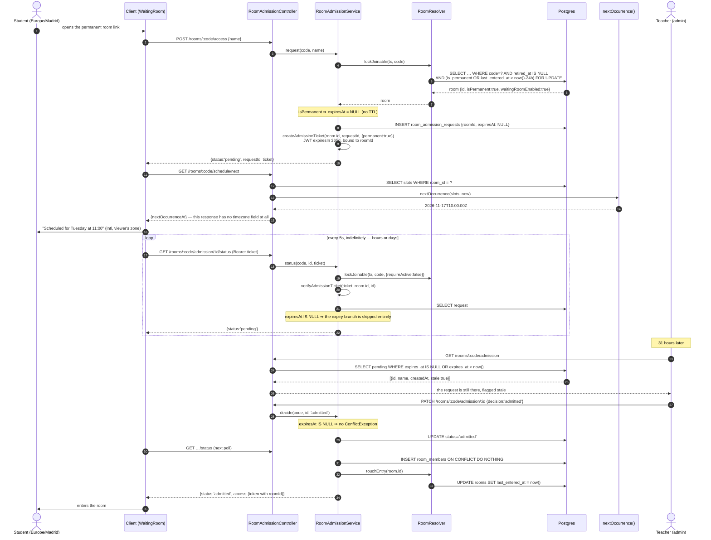
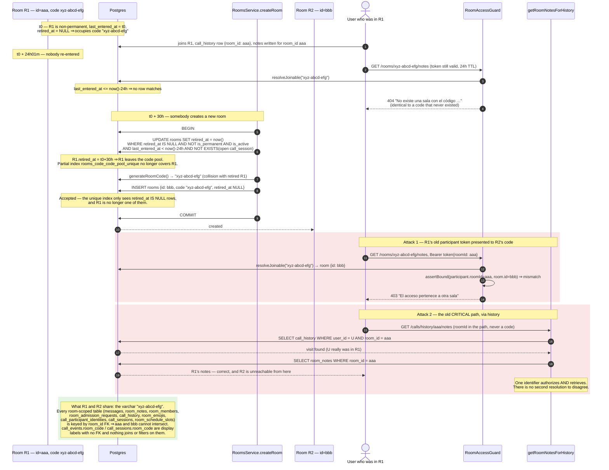

# Design: Permanent scheduled rooms with a mandatory waiting room

## Technical approach

Four coupled pieces, in dependency order:

1. **Identity hardening first.** A single `RoomResolver` becomes the only place in the codebase allowed to run `where(eq(rooms.code, …))` for live traffic. Every authorization and data-access path downstream of it takes a `roomId`. This is a prerequisite, not a follow-up: code recycling is only safe once no path keys on `code`.
2. **A stored retirement marker (`rooms.retired_at`) plus lazy time-based joinability.** The retirement marker exists because a Postgres partial index predicate must be `IMMUTABLE` and `now()` is not — the index cannot filter on "last entered within 24h". Joinability itself stays lazily derived so it is exact to the second with no scheduler.
3. **Admission branches on `room.isPermanent`** at ten enumerated sites in `room-admission.service.ts`, and — the non-obvious half — at the admission **ticket JWT** lifetime, which is a 24h expiry the client already maps to `expired`.
4. **Schedule slots + a pure next-occurrence function**, exposed through two separate endpoints so the owner's timezone has no field to leak into the student's response.

The central invariant everything else rests on:

```
joinable(room) := room.is_active
               AND room.retired_at IS NULL
               AND (room.is_permanent OR room.last_entered_at > now() - interval '24 hours')

code_pool_occupied(room) := room.retired_at IS NULL      -- time-free, indexable

joinable  ⊂  code_pool_occupied
```

The subset relation is what makes the partial unique index correct: two *joinable* rooms can never share a code, because a joinable room is always in the code pool, and the pool is uniquely indexed on `code`.

---

## Findings from the current code that shaped these decisions

These were verified by reading source, not inferred. Each one changes a decision:

| Finding | Evidence | Consequence |
|---|---|---|
| **`rooms.isActive` is never written.** No code path sets it. The only `update(rooms)` in the repo sets `waitingRoomEnabled` / `entryLocked`. | `rg "update\(rooms\)"` → only `room-admission.service.ts:160`. Read in 6 places, written in 0. | "Admin closed the room" is an *unimplemented* meaning, not a live one. See D1. |
| **`@nestjs/schedule` is not a dependency.** No `@Cron`, no `SchedulerRegistry`. | root `package.json` | A sweep job is net-new infrastructure, not a free tool. See D2. |
| **No timezone-aware date library.** No `luxon`, `date-fns-tz`, `dayjs`, `temporal-polyfill`. | root `package.json` | Next-occurrence either adds a dependency or uses Node's ICU. See D6. |
| **Node 24.15 with full ICU.** `Intl.supportedValuesOf('timeZone')` returns 418 zones; `longOffset` formatting works. | verified in the project's runtime | Zone-aware arithmetic is possible with zero dependencies. See D6. |
| **The admission ticket JWT expires in 24h**, independently of the DB `expires_at` column, and the client maps `401` → `{status:'expired'}`. | `room-access.service.ts:70`, `client/src/lib/api.ts:385` | Dropping the DB TTL alone does **not** satisfy the spec. See D7. |
| **`getRoomNotesForHistory` double-resolves by code**: authorizes with `eq(rooms.code, roomCode)` then re-resolves with `getRoomNotes(roomCode)`. | `calls.service.ts:344-353` | The CRITICAL risk is real and exploitable exactly as the proposal describes. See D4. |
| **The history-notes URL is keyed by `roomCode`**, both in the API route and the client page. | `call-history.controller.ts:23`, `client/src/app/history/notes/[roomCode]/page.tsx` | Fixing the vulnerability requires a route change, not just a query change. See D4. |
| **Webhook/close paths resolve `rooms.id` from the LiveKit room name (= code)** to stamp `call_sessions.room_id`. | `calls-webhook.service.ts:235`, `call-session-close.service.ts:180` | A late `room_finished` could attribute a session to the *new* room holding a recycled code. See D4. |
| **`DrizzleModule` is `@Global()`.** | `src/db/drizzle.module.ts:10` | A resolver needing only `DRIZZLE` can live in a leaf module and be imported by `JwtAuthModule` with no circular dependency. See D4. |
| **Code space is ~26^10 ≈ 1.4 × 10^14.** | `generate-room-code.ts` — three lowercase segments | Code *scarcity* is not a real pressure. The partial index is justified by **declared intent and recyclability**, not by exhaustion. This reframes the index as a correctness feature whose only real cost is the recycling attack surface — so the identity hardening (D4) is the load-bearing work of this change, not the index. |

---

## Architecture decisions

### D1 — Joinability gets its own column (`retired_at`); `isActive` is **not** reused

| Option | Tradeoff | Decision |
|---|---|---|
| New nullable `rooms.retired_at timestamp` | One more column; two flags to reason about | **Chosen** |
| Reuse `rooms.isActive` | Zero schema cost, and `joinRoom()` already rejects `!isActive` | Rejected |
| Separate `rooms.is_joinable boolean` | Equivalent to `retired_at` but loses *when* it happened | Rejected |

**Rationale — the two concepts genuinely diverge, and the difference is about the code pool:**

An admin closing a room is a **deliberate, reversible** act on a room whose link the admin already shared. Its code must stay **reserved** — releasing it would hand the admin's published link to a stranger's room. Inactivity retirement is **automatic, permanent**, and its whole purpose is to **release** the code.

One boolean cannot express the third state the system needs: *unjoinable but still holding its code*. If `isActive` were the index predicate, `CREATE UNIQUE INDEX … WHERE is_active` would bake "closing a room releases its code" into the schema — the wrong product behavior, silently.

The `isActive`-is-dead-code finding reinforces this rather than weakening it: overloading a column whose intended feature (admin close) is **not yet built** would pre-decide that unbuilt feature's semantics wrongly, and whoever implements room-closing later would have to undo this change to get it right.

`timestamp` rather than `boolean` because retirement is an event worth having the time of (support questions, and the retirement sweep's own observability) and because `retired_at IS NULL` reads unambiguously in the index predicate.

**User-visible consequence:** two distinct errors, which the current code conflates into one. `isActive = false` → `403 "La sala está cerrada"` (unchanged). Unknown-or-retired code → `404 "No existe una sala con el código …"`. The 404 is deliberate: a retired code and a never-existing code must be **indistinguishable**, or the error message itself becomes an oracle telling an attacker which codes used to exist.

### D2 — Expiry is lazily derived on read; retirement is written only when the code pool is consulted. No scheduler.

Three layers, each with a different job:

```
layer 1  lazy predicate in RoomResolver   → decides joinability. Exact to the second.
layer 2  sweep inside createRoom()'s tx   → sets retired_at. Makes the pool correct when it matters.
layer 3  partial unique index             → enforces the pool invariant in the database.
```

| Option | Tradeoff | Decision |
|---|---|---|
| Lazy predicate + retire-on-allocation | Two mechanisms to understand; `retired_at` can lag reality for rooms nobody tries to allocate over | **Chosen** |
| `@Cron` sweep flipping a stored flag, read paths test only the flag | Simple reads; but adds `@nestjs/schedule`, and leaves a window (one sweep interval) where an expired room is still joinable | Rejected |
| Pure lazy, no stored column at all | Fewest moving parts | **Impossible.** A partial index predicate must be `IMMUTABLE`; `now()` is `STABLE`. Postgres rejects `WHERE last_entered_at > now() - interval '24 hours'` with *"functions in index predicate must be marked IMMUTABLE"*. A stored marker is mandatory. |

**Rationale:**

The third row is the forcing constraint — the task's hypothesis is correct, a stored flag is unavoidable. The question is therefore only *who writes it*, and a scheduler is the wrong answer on two counts:

- **Correctness.** A sweep makes joinability granular to the sweep interval. A room 24h01m idle would still be joinable until the next tick. The lazy predicate has no such window.
- **Cost.** `@nestjs/schedule` is not installed, and a `@Cron` in this codebase inherits the single-instance assumption already documented for the in-memory close-timer map (`call-participation-timeline/design.md` D3). Adding a second place that silently depends on "there is exactly one API process" is a cost this change does not need to pay.

**Why retirement at allocation time is sufficient:** the *only* moment `retired_at` must be accurate is when `createRoom()` asks "is this code free?". So `createRoom()` makes it accurate, in its own transaction, immediately before probing:

```sql
UPDATE rooms
   SET retired_at = now()
 WHERE retired_at IS NULL
   AND is_permanent = false
   AND is_active = true
   AND last_entered_at < now() - interval '24 hours'
   AND NOT EXISTS (
         SELECT 1 FROM call_sessions cs
          WHERE cs.room_id = rooms.id
            AND cs.ended_at IS NULL
            AND cs.forced_close_at IS NULL
       );
```

Supported by `rooms_retirement_sweep_idx ON rooms (last_entered_at) WHERE retired_at IS NULL AND is_permanent = false`. The statement is self-limiting: each row is retired once, ever, so the working set is only rooms that crossed 24h since the last room creation. Room creation is a human-paced, rare operation — this is the cheapest possible place to put the write.

The `NOT EXISTS` guard is deliberately **only** in the sweep and not in the lazy predicate: retirement is irreversible and must be conservative, while the read predicate must stay a single-table query on a hot path.

**Rejected — layer 4, opportunistic retirement on the read path.** Tempting (`resolveJoinable` already knows the row is time-expired, one idempotent `UPDATE … WHERE retired_at IS NULL` would keep the column fresh). Rejected because it turns every `GET` on a dead code into a write, and a client polling a retired code would hammer it for no benefit — nothing reads `retired_at` except the index predicate and the sweep.

**Accepted consequence:** `retired_at` is a *lower bound*, not a timestamp of the exact expiry instant. It is a pool-management marker, never a source of truth for joinability or for anything user-visible. Any future UI wanting to show "expired at" must derive it from `last_entered_at + 24h`.

### D3 — Partial unique index: exact migration, with a self-gating rollback

`drizzle-kit` in this repo generates up-only SQL and the project has **no** `down` migrations (`drizzle/` holds 16 forward files, `drizzle/meta/_journal.json` tracks them). This migration is hand-written in the established style of `0015_room_admission.sql` (explicit `--> statement-breakpoint`, `ALTER TABLE … ADD COLUMN`, named constraints), with its journal entry and snapshot regenerated.

**Forward — `drizzle/0016_permanent_scheduled_rooms.sql`** (order matters: columns before the index that depends on them, drop the old constraint before creating the new index):

```sql
ALTER TABLE "rooms" ADD COLUMN "is_permanent" boolean DEFAULT false NOT NULL;--> statement-breakpoint
ALTER TABLE "rooms" ADD COLUMN "last_entered_at" timestamp DEFAULT now() NOT NULL;--> statement-breakpoint
ALTER TABLE "rooms" ADD COLUMN "retired_at" timestamp;--> statement-breakpoint

CREATE TABLE "room_schedule_slots" (
	"id" uuid PRIMARY KEY DEFAULT gen_random_uuid() NOT NULL,
	"room_id" uuid NOT NULL,
	"day_of_week" smallint NOT NULL,
	"time_of_day" varchar(5) NOT NULL,
	"timezone" varchar(64) NOT NULL,
	"created_at" timestamp DEFAULT now() NOT NULL,
	CONSTRAINT "room_schedule_slots_day_of_week_valid" CHECK ("day_of_week" between 0 and 6),
	CONSTRAINT "room_schedule_slots_time_of_day_valid" CHECK ("time_of_day" ~ '^([01][0-9]|2[0-3]):[0-5][0-9]$')
);
--> statement-breakpoint
ALTER TABLE "room_schedule_slots" ADD CONSTRAINT "room_schedule_slots_room_id_rooms_id_fk"
  FOREIGN KEY ("room_id") REFERENCES "public"."rooms"("id") ON DELETE cascade ON UPDATE no action;--> statement-breakpoint
ALTER TABLE "room_schedule_slots" ADD CONSTRAINT "room_schedule_slots_room_day_time_tz_unique"
  UNIQUE("room_id","day_of_week","time_of_day","timezone");--> statement-breakpoint
CREATE INDEX "room_schedule_slots_room_id_idx" ON "room_schedule_slots" USING btree ("room_id");--> statement-breakpoint

ALTER TABLE "room_admission_requests" ALTER COLUMN "expires_at" DROP NOT NULL;--> statement-breakpoint

ALTER TABLE "rooms" DROP CONSTRAINT "rooms_code_unique";--> statement-breakpoint
CREATE UNIQUE INDEX "rooms_code_code_pool_unique" ON "rooms" USING btree ("code") WHERE "retired_at" IS NULL;--> statement-breakpoint
CREATE INDEX "rooms_retirement_sweep_idx" ON "rooms" USING btree ("last_entered_at")
  WHERE "retired_at" IS NULL AND "is_permanent" = false;
```

Notes on the forward path:

- `last_entered_at … DEFAULT now() NOT NULL` gives every pre-existing room a **fresh 24h window starting at migration time**. No existing room retires on deploy. This is the gentle backfill the proposal's risk table requires, and it falls out of the column default for free.
- `is_permanent DEFAULT false` means every existing room keeps its current waiting-room behavior exactly (proposal: backfill is `false`).
- `expires_at DROP NOT NULL` is additive and reversible as long as no NULL rows exist — see the gate below.
- Dropping `rooms_code_unique` and creating `rooms_code_code_pool_unique` are **not** atomic with respect to concurrent writers, but they are in the same transaction (drizzle-kit wraps a migration file in one transaction), so no window exists where `code` is unconstrained.

**Rollback — `drizzle/rollback/0016_permanent_scheduled_rooms.down.sql`**, a new directory, documented as **manually executed** (never auto-applied; `drizzle-kit` has no down runner here). It self-gates: the duplicate-code check is a `DO` block that aborts the whole transaction rather than printing a warning a human can miss.

```sql
BEGIN;

DROP INDEX IF EXISTS "rooms_retirement_sweep_idx";
DROP INDEX IF EXISTS "rooms_code_code_pool_unique";

-- Gate 1: the global UNIQUE("code") cannot be restored if any code is duplicated.
DO $$
DECLARE duplicated int;
BEGIN
  SELECT count(*) INTO duplicated
    FROM (SELECT code FROM rooms GROUP BY code HAVING count(*) > 1) d;
  IF duplicated > 0 THEN
    RAISE EXCEPTION
      'Rollback aborted: % room code(s) are duplicated. Restoring the global unique constraint '
      'would fail. Preferred response: roll back APPLICATION CODE ONLY and leave this schema in '
      'place (the old code never wrote duplicate codes, so it is compatible). If the schema '
      'rollback is truly required, first rename the duplicated code on the RETIRED rows '
      '(retired_at IS NOT NULL) — never delete rows, they are history — then re-run this file.',
      duplicated;
  END IF;
END $$;

-- Gate 2: expires_at cannot become NOT NULL again while TTL-free requests exist.
DO $$
DECLARE ttl_free int;
BEGIN
  SELECT count(*) INTO ttl_free FROM room_admission_requests WHERE expires_at IS NULL;
  IF ttl_free > 0 THEN
    RAISE EXCEPTION
      'Rollback aborted: % admission request(s) have no TTL (expires_at IS NULL). Decide '
      'explicitly whether to backfill them (expires_at = created_at + interval ''24 hours'') '
      'or to leave this column nullable, then re-run.', ttl_free;
  END IF;
END $$;

ALTER TABLE "rooms" ADD CONSTRAINT "rooms_code_unique" UNIQUE("code");
ALTER TABLE "room_admission_requests" ALTER COLUMN "expires_at" SET NOT NULL;

DROP TABLE "room_schedule_slots";

ALTER TABLE "rooms" DROP COLUMN "retired_at";
ALTER TABLE "rooms" DROP COLUMN "last_entered_at";
ALTER TABLE "rooms" DROP COLUMN "is_permanent";

COMMIT;
```

Gate 2 is **new relative to the proposal's rollback plan**, which only anticipated the duplicate-code gate. Making `expires_at` nullable is just as irreversible once a permanent room has accumulated a TTL-free pending request, and it would fail at a different, later point in the down script. Both gates run before any destructive statement, inside one transaction, so a failed rollback leaves the database exactly as it was.

**Drizzle schema** (`src/db/schema.ts`) — `code` loses `.unique()`, and the index moves to the table-extras callback. `uniqueIndex().where()` is supported in `drizzle-orm` 0.45:

```ts
export const rooms = pgTable(
  'rooms',
  {
    id: uuid('id').defaultRandom().primaryKey(),
    code: varchar('code', { length: 20 }).notNull(),   // .unique() removed — see rooms_code_code_pool_unique
    name: varchar('name', { length: 100 }).notNull(),
    isActive: boolean('is_active').notNull().default(true),
    // Declared at creation and immutable (D5). Permanent rooms never expire and never recycle.
    isPermanent: boolean('is_permanent').notNull().default(false),
    // Drives the rolling 24h window for non-permanent rooms. Touched on "entry" (D5).
    lastEnteredAt: timestamp('last_entered_at').notNull().defaultNow(),
    // Code-pool marker, NOT a joinability source of truth (D2). NULL = this room holds its code.
    retiredAt: timestamp('retired_at'),
    waitingRoomEnabled: boolean('waiting_room_enabled').notNull().default(false),
    entryLocked: boolean('entry_locked').notNull().default(false),
    createdAt: timestamp('created_at').notNull().defaultNow(),
    chimeMeetingId: varchar('chime_meeting_id', { length: 64 }),
  },
  (table) => [
    uniqueIndex('rooms_code_code_pool_unique')
      .on(table.code)
      .where(sql`${table.retiredAt} is null`),
    index('rooms_retirement_sweep_idx')
      .on(table.lastEnteredAt)
      .where(sql`${table.retiredAt} is null and ${table.isPermanent} = false`),
  ],
);
```

### D4 — Code-recycling fix: one `RoomResolver`, and `roomId` inside every token

This is the highest-risk part of the change and the only part that is a security fix rather than a feature. It is designed as **one centralized resolution boundary**, not 13 independent patches, because the verification gate the proposal asks for (`rg "eq\(rooms\.code"` returns exactly one hit) only works if there is exactly one legitimate place for that expression.

#### The resolver

New `src/modules/rooms/room-resolver.service.ts`, exported by a new leaf `RoomResolverModule` that **imports nothing** — `DrizzleModule` is `@Global()`, so this breaks the cycle that would otherwise appear (`RoomsModule → JwtAuthModule → RoomsModule`). `JwtAuthModule`, `RoomsModule`, `CallsModule` and `ChatModule` all import `RoomResolverModule`.

```ts
const joinable = (t: typeof rooms) => and(
  isNull(t.retiredAt),
  or(eq(t.isPermanent, true), gt(t.lastEnteredAt, sql`now() - interval '24 hours'`)),
);

class RoomResolver {
  /** The ONLY place in the codebase allowed to query rooms by code for live traffic. */
  resolveJoinable(code: string): Promise<Room>;              // 404 if unknown/retired/expired, 403 if !isActive
  lockJoinable(tx, code, opts?: { requireActive?: boolean }): Promise<Room>;  // same, FOR UPDATE
  /** Binds a token to a room identity. Throws 403 when the token's roomId is not this room. */
  assertBound(participant: RoomParticipant, room: Room): void;
  getById(roomId: string): Promise<Room | undefined>;        // history/read-only paths — no code involved
  touchEntry(roomId: string, tx?): Promise<void>;            // last_entered_at = now() (D5)
  retireExpired(tx): Promise<void>;                          // the allocation-time sweep (D2)
}
```

`resolveJoinable` returns `404` for retired **and** expired **and** never-existed, deliberately indistinguishable (D1).

#### The 13 call sites, by category

**Category A — already funnel through `RoomsService.findByCode`; fixed for free.** `findByCode` / `getByCodeOrThrow` become one-line delegations to `resolveJoinable`, so these change behavior without changing their own code:

- `rooms.service.ts` — `joinRoom`, `listMembers`, `getMemberRole`, `setMemberRole`, `getRoomNotes`, `saveRoomNotes` (6 sites)
- `rooms.controller.ts:46` — `findOne`
- `room-emojis.service.ts:136,155,202,264,299` (5 sites)
- `calls.service.ts:54` — `join`

**Category B — raw `eq(rooms.code, …)` queries; routed through the resolver.**

- `room-admission.service.ts:26` `lockRoom` → `resolver.lockJoinable(tx, code, { requireActive })`. Keeps `FOR UPDATE`.
- `room-admission.service.ts:128` `list` → `resolver.resolveJoinable(code)`.

**Category C — the vulnerability. `calls.service.ts:344-353` `getRoomNotesForHistory`.**

Current shape, verbatim, and why it is exploitable:

```ts
.where(and(eq(callHistory.userId, userId), eq(rooms.code, roomCode)))   // authorizes on R1's code
.limit(1);                                                               // no ORDER BY — arbitrary row
if (!visit) throw new ForbiddenException(…);
return this.roomsService.getRoomNotes(roomCode);                         // re-resolves the code → R2
```

The authorization query and the data query resolve the code **independently**. After recycling, the user's history row in retired R1 satisfies the check, and the second resolution returns R2's notes. The `.limit(1)` without `ORDER BY` makes which room is checked nondeterministic.

Fix — the method stops taking a code at all:

```ts
async getRoomNotesForHistory(userId: string, roomId: string) {
  const [visit] = await this.db
    .select({ roomId: callHistory.roomId })
    .from(callHistory)
    .where(and(eq(callHistory.userId, userId), eq(callHistory.roomId, roomId)))
    .limit(1);
  if (!visit) throw new ForbiddenException('No tenés historial en esta sala');
  return this.roomsService.getRoomNotesById(roomId);
}
```

No `rooms` join, no code, one identifier used for both authorization and retrieval. Structurally impossible to get wrong — there is no second resolution to disagree with the first.

This forces an API and route change, which is the honest cost of the fix:

| Before | After |
|---|---|
| `GET /calls/history/:roomCode/notes` | `GET /calls/history/:roomId/notes` (`ParseUUIDPipe`) |
| `CallHistoryEntry = { roomCode, roomName, startedAt, sessionId }` | `+ roomId` (`listHistory` already selects it internally at `calls.service.ts:289` — it is simply not returned) |
| `client/src/app/history/notes/[roomCode]/page.tsx` | `client/src/app/history/notes/[roomId]/page.tsx` |
| `client/src/app/history/page.tsx:100` links by `entry.roomCode` | links by `entry.roomId` |

`roomCode` stays in `CallHistoryEntry` as the **display label** only. UUID-in-path is already the established pattern here (`/history/[sessionId]`).

`RoomsService` gains id-keyed twins — `getRoomNotesById(roomId)`, `saveRoomNotesById(roomId, …)` — and the existing code-keyed methods become two-liners: resolve once, delegate. That is the "resolve code→id once at the boundary, pass id downstream" pattern, applied uniformly.

**Category D — webhook and session-close paths. `calls-webhook.service.ts:235`, `call-session-close.service.ts:180`.**

Both do `select({id: rooms.id}).from(rooms).where(eq(rooms.code, roomCode))` to stamp `call_sessions.room_id`, using the LiveKit room name as the code. A `room_finished` webhook arriving after the room retired and the code was reused would attribute the finished session — and therefore its whole participation timeline — to the **new** room.

Fix: **delete both lookups** and resolve the room from the authoritative link that already exists. `CallsService.join()` writes `call_participant_identities` with the real `roomId` (`calls.service.ts:114-126`) for every participant before issuing their token. So:

```ts
const [identity] = await tx
  .select({ roomId: callParticipantIdentities.roomId })
  .from(callParticipantIdentities)
  .where(inArray(callParticipantIdentities.livekitIdentity, identityKeys))
  .limit(1);
// roomId stays null when no identity is known — the column is already nullable.
```

`onRoomFinished` already computes `identityKeys` (line 257) for exactly this set; `ensureSessionRow` can derive it from the same `call_events` query it already runs. This is strictly better than the code lookup — it is the same identifier LiveKit-side events are already correlated by — and it removes two `eq(rooms.code)` sites rather than hardening them. `call_events.room_code` and `call_sessions.room_code` remain plain display labels with no FK, exactly as the timeline design intended; nothing joins or filters on them.

**Category E — chat gateway. `chat.gateway.ts:135`.**

`findByCode` → `resolver.resolveJoinable(dto.code)` (emitting the existing `error` event instead of throwing, since this is a Socket.io handler), then `resolver.assertBound(participant, room)`. `connectedUsers` already stores `roomId` alongside `roomCode` (line 157), and `chatService.getHistory(room.id)` is already id-keyed — only the resolution and the binding check change.

#### Token binding

`RoomParticipant` gains a **required** `roomId`:

```ts
export interface RoomParticipant {
  kind: 'room-participant';
  sub: string;
  roomId: string;      // NEW — the stable identity. roomCode is a convenience label.
  roomCode: string;
  name: string;
  userId?: string;
}
```

- `RoomAccessService.create(roomId, roomCode, name, auth)` and `issueParticipant` carry it; `verify()` rejects a payload without `roomId`.
- `createAdmissionTicket(roomId, requestId, { permanent })` / `verifyAdmissionTicket(token, roomId, requestId)` switch from `roomCode` to `roomId`. The controller no longer has the id, so the **service** verifies the ticket *after* resolving the room — `status()` and `cancel()` move the `verifyAdmissionTicket` call inside the transaction, after `lockJoinable`.
- `RoomAccessGuard` does the binding check in one place so no handler can forget it: resolve `request.params.roomCode` via `resolveJoinable`, `assertBound(participant, room)`, attach `request.room`. It can inject `RoomResolver` because `RoomResolverModule` is a leaf.
- `WsJwtAuthGuard` keeps its cheap string compare (`participant.roomCode !== data.code`); the authoritative id check happens in `handleJoinRoom` via `assertBound`, because only `joinRoom` has a resolvable code — the other 10 `@SubscribeMessage` handlers operate on the already-validated `connectedUsers` entry, which carries `roomId`.

**Accepted cost:** `GifsController` is `RoomAccessGuard`-protected and currently never touches the database (`gifs.controller.ts` only proxies Tenor). It now pays one indexed `SELECT` per search. Accepted: without it, a stale token for a recycled code can spend the new room's API quota, which is precisely the class of bug this change exists to close.

**Decision — legacy tokens issued before this deploy are rejected.** Tokens live 24h, so without a transition path, `verify()` returning `UnauthorizedException` for a payload lacking `roomId` logs out everyone currently in a room.

| Option | Tradeoff | Decision |
|---|---|---|
| Reject tokens without `roomId` | Participants active at deploy time are returned to the name form; mid-call participants are interrupted | **Chosen** |
| Accept `roomId`-less tokens for one release | No interruption, but the vulnerability stays open for 24h and the code grows a branch that must be remembered and removed | Rejected |

Rationale: a dual-path `verify()` is a security check with an "or else trust the old shape" clause — the exact shape of bug that outlives its deadline. The blast radius of rejecting is bounded and self-healing: the client already treats `401` as "request access again" (`client/src/lib/api.ts:385`, `useAdmissionRequest` reset path), and the first recyclable code cannot exist until at least 24h after deploy anyway. Mitigation is operational, not architectural: deploy at low traffic.

#### Verification gate

After this change, `rg "eq\(rooms\.code"` over `src/` (excluding `*.spec.ts`) must return **exactly one** hit: inside `room-resolver.service.ts`. Any other hit is a review blocker. This is the mechanical check the proposal's risk table asks for, and it is only meaningful because of the single-boundary design.

### D5 — "Entry", and the open questions the specs left to design

**`last_entered_at` is touched on three events, all of which mean "a human got access to this room":**

| Site | Why |
|---|---|
| `RoomsService.joinRoom()` | An account joining the room |
| `RoomAdmissionService.grant()` | An access pass was issued — the only "entry" moment guests and admitted students have |
| `CallsService.join()` | Joining the call |

**Not** on: chat messages, note edits, emoji uploads, admission status polling. Rationale: polling must never keep a room alive (a forgotten browser tab would make every room permanent), and chat/notes are *inside* a room someone already entered — if nobody entered for 24h, nobody is chatting either. `grant()` is the important one: without it, a guest-only room would expire despite continuous use, because guests never reach `joinRoom()`.

**In-progress calls** are protected by the `NOT EXISTS (open call_session)` clause in the retirement sweep (D2), not by the lazy predicate. Residual, accepted: a room whose call ran 24h straight with zero new joins becomes unjoinable to *new* arrivals while the existing participants stay connected (LiveKit holds them; they do not re-resolve the code). Implausible in practice, and the failure mode is a correct-but-early "code no longer valid" rather than data loss.

**Remaining open questions, decided here:**

| Question (spec Non-Goal) | Decision | Rationale |
|---|---|---|
| Can `isPermanent` be toggled after creation? | **No. Immutable in v1.** Absent from every update DTO; no endpoint accepts it. | `true → false` makes a published "forever" link expirable and its code recyclable — breaking a user-visible promise *and* handing the teacher's link to a stranger. `false → true` is harmless but has no demand and would need its own forced-waiting-room migration for existing pending requests. Immutability costs nothing now and can be relaxed later; the reverse is not true. |
| Can slots be edited/deleted after creation? | **Yes.** Admin-only `POST /rooms/:code/schedule/slots` and `DELETE /rooms/:code/schedule/slots/:slotId`. | A timetable changes, and the proposal leaned yes. Cheap because **no state is derived from slots** — next-occurrence is computed on read, so editing a slot has no cascade. An immutable schedule would force teachers to recreate the room, destroying the permanent link this change exists to provide. |
| Bulk admission? | **Not in v1.** `decide()` stays one-at-a-time. | `decide()` is keyed on a single `requestId` and runs one transaction per decision; a bulk path needs its own partial-failure semantics (all-or-nothing vs. best-effort) and its own UI affordance. Out of scope, and the admission spec explicitly preserves one-at-a-time. Revisit with real complaints. |
| Pending-request hygiene with no TTL? | **A read-time soft `stale` flag.** `list()` returns `stale: createdAt < now - 24h` per request. No cap, no TTL, no new column. | Zero schema cost, zero new behavior, zero new failure mode — and it gives the teacher exactly the signal the risk table asks for ("this person asked two weeks ago"). A cap would silently hide real students; a TTL is forbidden by the spec. Sorting/filtering by `stale` is a client concern. |
| Slot duration / "in-progress" occurrence? | **No duration.** A slot is a start instant only. | The schedule spec declares it a Non-Goal, and adding a duration would require deciding what "in progress" *means* when entry is never gated by the schedule — it would be a label with no behavior behind it. |

### D6 — Schedule storage and next-occurrence: server-side, pure, zero new dependencies

**Table — `room_schedule_slots`:**

```ts
export const roomScheduleSlots = pgTable(
  'room_schedule_slots',
  {
    id: uuid('id').defaultRandom().primaryKey(),
    roomId: uuid('room_id').notNull().references(() => rooms.id, { onDelete: 'cascade' }),
    // 0 = Sunday … 6 = Saturday — same convention as JS Date#getDay().
    dayOfWeek: smallint('day_of_week').notNull(),
    // 'HH:MM', 24h wall-clock in `timezone`.
    timeOfDay: varchar('time_of_day', { length: 5 }).notNull(),
    // IANA zone name, never a numeric offset (spec: room-schedule).
    timezone: varchar('timezone', { length: 64 }).notNull(),
    createdAt: timestamp('created_at').notNull().defaultNow(),
  },
  (table) => [
    index('room_schedule_slots_room_id_idx').on(table.roomId),
    unique('room_schedule_slots_room_day_time_tz_unique')
      .on(table.roomId, table.dayOfWeek, table.timeOfDay, table.timezone),
    check('room_schedule_slots_day_of_week_valid', sql`${table.dayOfWeek} between 0 and 6`),
    check('room_schedule_slots_time_of_day_valid',
      sql`${table.timeOfDay} ~ '^([01][0-9]|2[0-3]):[0-5][0-9]$'`),
  ],
);
```

| Choice | Rationale |
|---|---|
| `smallint` day-of-week with `0 = Sunday`, not a `pgEnum` | Numeric ordering is needed by the occurrence computation, and the convention matches `Date#getDay()` so there is no translation layer to get wrong. A `CHECK between 0 and 6` gives the same validation an enum would. |
| `varchar(5)` + regex `CHECK`, not Postgres `time` | `time` round-trips as `'07:00:00'`, forcing normalization on every read and every API response. `varchar` is byte-identical in and out, sidesteps the `time with/without time zone` trap entirely, and the `CHECK` makes the database reject malformed values. Matches the project's existing habit of `varchar` + `check` (see the `room_emojis` constraints). |
| `varchar(64)` for the zone | Longest current IANA name is 32 chars; 64 is comfortable headroom. |
| `UNIQUE(roomId, dayOfWeek, timeOfDay, timezone)` | Prevents duplicate slots, which would otherwise be invisible in the UI and harmless-but-confusing in the computation. |
| `ON DELETE cascade` | Slots have no meaning without their room. Matches every other room-scoped table. |
| No `isActive` / soft delete on slots | Deletion is the edit mechanism (D5) and nothing derives state from a slot. |

**Next-occurrence — a pure function, `src/modules/rooms/schedule/next-occurrence.ts`:**

```ts
export interface ScheduleSlot { dayOfWeek: number; timeOfDay: string; timezone: string }
export function nextOccurrence(slots: ScheduleSlot[], now: Date): Date | null;
```

Algorithm, per slot:

1. Read `now`'s calendar parts **in the slot's zone** via `Intl.DateTimeFormat('en-US', { timeZone, hour12: false, … })`.
2. For `ahead` in `0..7`, convert the wall-clock `(y, m, d + ahead, hh, mm)` in that zone to an instant using a two-pass offset correction:
   ```
   guess = Date.UTC(y, m - 1, d + ahead, hh, mm)        // Date.UTC normalizes day overflow
   t     = guess - offsetAt(guess)                       // pass 1
   t     = guess - offsetAt(t)                           // pass 2: fixes a DST boundary crossed by pass 1
   ```
   where `offsetAt(instant)` is derived by formatting `instant` in the zone and re-reading it as UTC.
3. Skip candidates at or before `now`; skip candidates whose day-of-week **in the zone** (re-derived from the resulting instant, not from arithmetic) does not match `slot.dayOfWeek`; take the first survivor.
4. Return the earliest instant across all slots, or `null` when the room has no slots.

Re-deriving the day-of-week from the computed instant rather than trusting the arithmetic is what makes this correct across DST transitions — the offset correction can move an instant across midnight, and the zone is the only authority on which day that is.

**DST edge cases** (the schedule spec declares deep DST handling a Non-Goal, so the behavior is *defined* here rather than left to chance — the function never throws and never returns a wrong-day result):

| Case | Behavior |
|---|---|
| Wall time does not exist (spring forward) | The two-pass lands on the instant immediately after the gap — the occurrence fires at the next existing wall minute. |
| Wall time is ambiguous (fall back) | Pass 1's offset wins, deterministically yielding the **first** (pre-transition) of the two instants. |
| Slot's zone has a mid-year offset change | Irrelevant — the offset is resolved per candidate instant, never cached. |

Both get explicit unit tests across a real Southern-Hemisphere and a real Northern-Hemisphere transition.

| Option | Tradeoff | Decision |
|---|---|---|
| Node `Intl` + ~40 lines of pure code | No dependency; DST rules come from the platform's ICU, updated with Node | **Chosen** |
| `luxon` | `DateTime.fromObject({…}, {zone})` solves this in one line and handles ambiguity explicitly (`.isValid`, offset options) | Rejected for v1 — documented escape hatch |
| `date-fns-tz` | Smaller, but its zone handling is a thinner wrapper over the same `Intl` primitives this function uses directly | Rejected |

Rationale: this is one pure, fully unit-testable function over a platform capability that was **verified present** in the project's runtime (418 zones, `longOffset` formatting). A dependency for 40 lines of testable code is not worth the supply-chain and version surface. The honest counterweight: if the DST tests turn into a fight, `luxon` is a one-dependency, zero-config escape hatch and switching to it is a local change behind this exact signature. That is a deliberate, named fallback — not a hope.

**Where it runs — the server, exposed through two deliberately asymmetric endpoints:**

| Endpoint | Auth | Returns |
|---|---|---|
| `GET /rooms/:code/schedule/next` | none (public, like the waiting room) | `{ nextOccurrenceAt: string \| null }` — one ISO-8601 UTC instant |
| `GET /rooms/:code/schedule/slots` | `JwtAuthGuard` + `RoomRolesGuard('administrador')` | the full slot list, including `timezone` |

The student-facing endpoint **has no field that could carry the owner's timezone**. The spec requirement "the owner's timezone never reaches the viewer" is enforced by the response shape, not by remembering to strip a field — the only correct way to enforce a negative requirement. The client formats the instant with `Intl.DateTimeFormat(undefined, { weekday: 'long', hour: 'numeric', minute: '2-digit' })`, which uses the viewer's own zone by definition, so no new client dependency either.

Computing on the client was rejected for the same reason: it would require shipping the slots — and therefore the owner's timezone — to the browser.

**Zone validation** at write time: the create-slot DTO validates `timezone` against `Intl.supportedValuesOf('timeZone')` (a custom `class-validator` constraint). A typo'd zone must fail at `POST`, not silently produce a `null` next occurrence forever.

### D7 — Admission TTL branching: the exact sites

All in `src/modules/rooms/room-admission.service.ts` unless noted. Line numbers are pre-change.

| Site | Today | Change |
|---|---|---|
| `:25-30` `lockRoom` | `eq(rooms.code, code)` + `isActive` check | `resolver.lockJoinable(tx, code, { requireActive })` (D4) |
| `:69` `request` | `const expiresAt = new Date(Date.now() + 24h)` | `const expiresAt = room.isPermanent ? null : new Date(Date.now() + 24h)` |
| `:76` `request` | `createAdmissionTicket(code, id)` | `createAdmissionTicket(room.id, id, { permanent: room.isPermanent })` — **the non-obvious blocker, below** |
| `:96` `status` | `if (request.expiresAt <= new Date())` | `if (request.expiresAt && request.expiresAt <= new Date())` |
| `:128` `list` | `eq(rooms.code, code)` | `resolver.resolveJoinable(code)` (D4) |
| `:142` `list` | `gt(roomAdmissionRequests.expiresAt, new Date())` | `or(isNull(expiresAt), gt(expiresAt, new Date()))` |
| `:146-150` `list` | returns `requests` | adds `stale: createdAt < now - 24h` per request (D5) |
| `:156-159` `configure` | `waitingRoomEnabled: settings.waitingRoomEnabled ?? room.waitingRoomEnabled` | `if (room.isPermanent && settings.waitingRoomEnabled === false) throw new ForbiddenException('La sala de espera no se puede desactivar en una sala permanente')`, then force `waitingRoomEnabled: room.isPermanent ? true : (settings.… ?? room.…)` |
| `:163-173` `configure` | auto-admits pending requests when the waiting room is turned off | unreachable for permanent rooms (`next.waitingRoomEnabled` is forced `true`); its `gt(expiresAt, …)` filter still becomes `or(isNull(…), gt(…))` for the non-permanent path |
| `:182` `decide` | `if (request.expiresAt <= new Date()) throw Conflict` | `if (request.expiresAt && request.expiresAt <= new Date()) throw Conflict` |

Plus, outside this file:

- `rooms.service.ts createRoom` — a permanent room is inserted with `waitingRoomEnabled: true` (the column default is `false`, so this is required for the spec's "permanent room always requires admission" scenario to hold from the first second).
- `schema.ts` — `roomAdmissionRequests.expiresAt` becomes nullable (`timestamp('expires_at')`, no `.notNull()`).

**Why nullable and not a far-future sentinel:** a sentinel (`9999-12-31`) puts a lie in the data. A future reader cannot distinguish "intentionally has no TTL" from "expires in the year 9999", every query keeps a time comparison that is now meaningless, and the rollback gate cannot tell TTL-free rows apart from real ones. `NULL` means exactly "no TTL" and makes every call site declare its intent via `isNull()`.

**The non-obvious blocker — the ticket JWT.** `createAdmissionTicket` signs with `expiresIn: '24h'` (`room-access.service.ts:70`). The client maps `401` → `{status: 'expired'}` (`client/src/lib/api.ts:385`), and `useAdmissionRequest` renders that as a terminal state. **So removing the DB TTL alone does not satisfy the spec** — at hour 24 the student's poll gets a `401` from the dead ticket and the UI says "La solicitud venció" even though the row is still `pending` and still decidable by the teacher. The spec scenario "pending request older than 24 hours is still decidable" would pass at the service layer and fail for the actual user.

Fix: `expiresIn: permanent ? '365d' : '24h'`.

| Option | Tradeoff | Decision |
|---|---|---|
| `365d` for permanent rooms | Still bounded, exceeds any plausible wait | **Chosen** |
| No expiry at all | An unbounded bearer token is a standing liability, and the ticket is the only credential guarding `cancel()` | Rejected |
| Re-issue the ticket from `status()` when it nears expiry | Correct and unbounded, but adds a refresh protocol to a 5-second polling loop for a problem `365d` already solves | Rejected — revisit only if a year is genuinely insufficient |

**`entryLocked` is untouched on permanent rooms.** It means "stop accepting new requests right now" — a transient, legitimate admin action orthogonal to the waiting room. The admission spec forbids disabling the *waiting room*; it says nothing about locking entry, and conflating them would take a working tool away from teachers.

---

## Sequence diagrams

### Flow 1 — Student waits in a permanent room while the teacher is absent

The point of this diagram is what is **absent**: no TTL timer, no "too early" rejection, no scheduler. The student's wait is bounded only by the teacher.



### Flow 2 — Code-recycling lifecycle: proof that R1 and R2 share nothing



---

## File-level impact

### New

| File | Purpose |
|---|---|
| `src/modules/rooms/room-resolver.service.ts` | The single code→room boundary (D4) |
| `src/modules/rooms/room-resolver.service.spec.ts` | Joinability predicate, binding check, sweep |
| `src/modules/rooms/room-resolver.module.ts` | Leaf module; breaks the `RoomsModule ↔ JwtAuthModule` cycle |
| `src/modules/rooms/schedule/next-occurrence.ts` | Pure slots + now → instant (D6) |
| `src/modules/rooms/schedule/next-occurrence.spec.ts` | Multi-slot ordering, DST transitions both hemispheres, empty slots |
| `src/modules/rooms/schedule/room-schedule.service.ts` | Slot CRUD + next-occurrence orchestration |
| `src/modules/rooms/schedule/room-schedule.service.spec.ts` | — |
| `src/modules/rooms/schedule/room-schedule.controller.ts` | The two asymmetric endpoints (D6) |
| `src/modules/rooms/dto/create-schedule-slot.dto.ts` | Day/time/IANA-zone validation |
| `src/modules/rooms/validators/is-iana-timezone.validator.ts` | `Intl.supportedValuesOf('timeZone')` constraint |
| `drizzle/0016_permanent_scheduled_rooms.sql` | Forward migration (D3) |
| `drizzle/rollback/0016_permanent_scheduled_rooms.down.sql` | Gated manual rollback (D3) |
| `drizzle/rollback/README.md` | States that these are manual and never run by `drizzle-kit migrate` |
| `client/src/features/rooms/NextOccurrence.tsx` | Renders the instant in the viewer's zone |
| `client/src/features/rooms/ScheduleSlotEditor.tsx` | Admin weekly slot editor |

### Modified

| File | Change |
|---|---|
| `src/db/schema.ts` | `rooms`: `isPermanent`, `lastEnteredAt`, `retiredAt`, `code` loses `.unique()`, two partial indexes. `roomAdmissionRequests.expiresAt` nullable. New `roomScheduleSlots` + relations. |
| `src/modules/rooms/rooms.service.ts` | `createRoom(name, creatorId, {isPermanent, slots})` — sweep + insert + members + slots in one transaction; `findByCode`/`getByCodeOrThrow` delegate to the resolver; new id-keyed `getRoomNotesById`/`saveRoomNotesById`; `joinRoom` touches `lastEnteredAt` |
| `src/modules/rooms/room-admission.service.ts` | The ten sites in D7 |
| `src/modules/rooms/rooms.controller.ts` | `create` accepts the new DTO fields |
| `src/modules/rooms/dto/create-room.dto.ts` | `isPermanent?: boolean`, `slots?: CreateScheduleSlotDto[]` |
| `src/modules/rooms/dto/update-admission.dto.ts` | Unchanged shape; rejection happens in the service where `isPermanent` is known |
| `src/modules/rooms/rooms.module.ts` | Imports `RoomResolverModule`; registers the schedule controller/service |
| `src/modules/rooms/guards/room-roles.guard.ts` | Unchanged — already funnels through `getMemberRole` → resolver |
| `src/modules/auth/room-access.service.ts` | `RoomParticipant.roomId`; `create`/`issueParticipant` carry it; `verify` requires it; admission ticket binds `roomId` and takes `{permanent}` for the 365d lifetime |
| `src/modules/auth/guards/room-access.guard.ts` | Resolves the room, calls `assertBound`, attaches `request.room` |
| `src/modules/auth/guards/ws-jwt-auth.guard.ts` | Unchanged string compare; documents that the id check lives in `handleJoinRoom` |
| `src/modules/auth/jwt-auth.module.ts` | Imports `RoomResolverModule` |
| `src/modules/calls/calls.service.ts` | `getRoomNotesForHistory(userId, roomId)` rewritten (D4-C); `listHistory` returns `roomId`; `join` touches `lastEnteredAt`; `join`/`reportTrackState` compare `participant.roomId` |
| `src/modules/calls/call-history.controller.ts` | Route `:roomCode` → `:roomId` with `ParseUUIDPipe` |
| `src/modules/calls/calls-webhook.service.ts` | Code lookup at `:235` deleted; `roomId` from `call_participant_identities` (D4-D) |
| `src/modules/calls/call-session-close.service.ts` | Same at `:180` |
| `src/modules/chat/chat.gateway.ts` | `resolveJoinable` + `assertBound` in `handleJoinRoom` |
| `src/modules/gifs/gifs.controller.ts` | No code change; now pays one guard query (documented cost) |
| `client/src/lib/api.ts` | `Room` gains `isPermanent`; `RoomAccess.participant` gains `roomId`; `CallHistoryEntry` gains `roomId`; notes-history path by id; `AdmissionManagement.requests[].stale`; schedule endpoints |
| `client/src/features/rooms/WaitingRoom.tsx` | Renders `NextOccurrence` |
| `client/src/features/rooms/useAdmissionRequest.ts` | No `expired` transition for permanent rooms |
| `client/src/features/rooms/AdmissionControl.tsx` | Shows `stale`; hides the waiting-room toggle on permanent rooms |
| `client/src/app/history/notes/[roomCode]/page.tsx` | Renamed to `[roomId]` |
| `client/src/app/history/page.tsx` | Links by `roomId` |
| Room creation UI | Permanent toggle + slot editor |

---

## Risks introduced or changed by this design

| Risk | Severity | Mitigation |
|---|---|---|
| **Legacy participant tokens are rejected at deploy**, interrupting anyone mid-call (D4). | Medium | Accepted deliberately over a dual-path `verify()`. Deploy at low traffic; the client's existing `401` → re-request path makes recovery two clicks. |
| **`retired_at` lags reality.** It is set only at allocation time, so an idle room can be unjoinable for days with `retired_at IS NULL`. | Low | By design (D2). Nothing but the index predicate and the sweep reads it. Any UI needing "expired at" must derive it from `last_entered_at + 24h` — stated here so nobody later treats the column as a source of truth. |
| **A 24h+ call with zero new joins blocks new arrivals.** The sweep protects the room from retirement but the lazy predicate does not. | Low | Accepted (D5). Any join refreshes the window; the failure mode is an early 404, not data loss. |
| **The `GifsController` guard now hits the database** on a path that previously did not. | Low | One indexed `SELECT`. Closes the stale-token-spends-new-room's-quota hole. |
| **DST correctness rests on hand-rolled offset arithmetic** rather than a vetted library (D6). | Medium | Two-pass correction + day-of-week re-derived from the resulting instant + explicit unit tests on real transitions in both hemispheres. Named escape hatch: swap in `luxon` behind the same `nextOccurrence` signature. |
| **The history-notes route changes shape**, breaking any bookmarked `/history/notes/<code>` URL. | Low | Unavoidable: the code-keyed route *is* the vulnerability. The page is reachable in two clicks from `/history`. |
| **Permanent rooms accumulate pending requests forever.** | Medium | Soft `stale` flag (D5). No TTL (forbidden), no cap (would hide real students). Revisit with a real teacher's list. |
| **One missed `eq(rooms.code)` site re-opens the recycling hole.** | High | The single-boundary design makes `rg "eq\(rooms\.code"` returning exactly one hit a mechanical, reviewable gate. |

---

## Testing notes for `sdd-tasks`

`strict_tdd: true`. Beyond colocated unit specs, three things need coverage that ordinary unit tests will not produce on their own:

1. **A real recycled-code scenario against Postgres**, not mocks: create R1 → backdate `last_entered_at` → create R2 and force the same code → assert R1's notes/members/history are unreachable through R2's code and that R1's token is rejected by R2. Mocked Drizzle cannot exercise the partial index, which is half the mechanism. The `docker-compose.test.yml` + `test:e2e:db:migrate` setup already provides a migrated Postgres for this.
2. **The migration's own gates.** Seed a database with a duplicated code and assert the down script *aborts* and leaves the schema untouched. The proposal asks for the duplicate query to be run before trusting the down path; making it an assertion is strictly better than making it a checklist item.
3. **The ticket-lifetime regression.** A test that a permanent room's pending request is still `pending` *and still has a verifiable ticket* at hour 25. Asserting only the DB row would have passed before this design existed, while the real user saw "expired".
